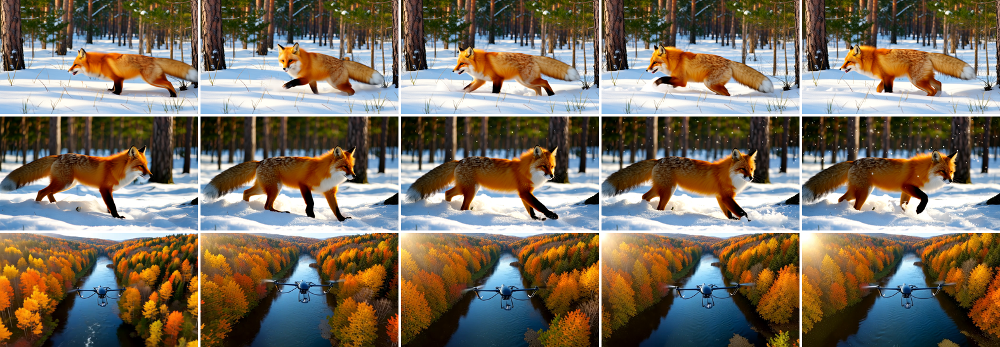

# Self Gradient Forcing+ for ComfyUI

Text-to-video in ComfyUI with the official **Self Gradient Forcing+ (SGF+)** models
([Zihan-Su/Self_Gradient_Forcing_Plus](https://github.com/Zihan-Su/Self_Gradient_Forcing_Plus), paper
[arXiv:2610.10429](https://arxiv.org/abs/2610.10429), *Decoupling Gradient Flows for Autoregressive Video Generation*). SGF+ is an
autoregressive Wan2.1-T2V-1.3B: it generates a video block by block with 4 denoising steps per block, and a separate
"memory" expert writes each finished block into the attention cache. With the official rolling cache the same model keeps going far
beyond its 5 s training window. Everything runs **inside the ComfyUI process**; the nodes never download anything.

> **Unofficial.** This node pack is an independent integration. It is not affiliated with or endorsed by the SGF+ authors, by the
> Wan team (Alibaba) or by Comfy Org.
>
> 日本語の概要は [README.ja.md](README.ja.md) にあります。



*Rows: chunkwise and framewise, 81 frames each ("A red fox trotting through fresh snow in a pine forest, morning light,
cinematic.", seed 42); chunkwise, 321 frames ("A drone flies slowly along a winding river through autumn forests, aerial view.",
seed 7). Default settings, real ComfyUI queue.*

## What it does

| Node | Purpose |
| --- | --- |
| **SGF+ Loader** | Picks an SGF+ checkpoint from `models/sgf_plus`, its variant (chunkwise / framewise), where the text encoder lives, and a keep-loaded switch |
| **SGF+ Text to Video** | Prompt, seed, length in latent frames, long-video cache → `IMAGE` frames (832 x 480), `fps` (16) and a JSON report |
| **SGF+ Unload** | Frees the resident model (GPU and RAM) |

Connect the frames to ComfyUI's own **Create Video** (fps from the node) and **Save Video**; the shipped workflows do exactly that.

Supported models: **`ZihanSu/Self_Gradient_Forcing_Plus`** `chunkwise/model.pt` (3 latent frames per block, the faster one) and
`framewise/model.pt` (1 latent frame per block), with the **`Wan-AI/Wan2.1-T2V-1.3B`** text encoder (umT5-XXL), VAE and base
configuration. Text-to-video only.

## How far it was checked

Windows 11, RTX 5090 (32 GB), ComfyUI v0.38.0 (details and raw numbers in [docs/VERIFICATION.md](docs/VERIFICATION.md)):

- **Bit-identical to the official code.** In an environment with upstream's pinned libraries (Python 3.11, torch 2.8.0, diffusers
  0.31.0, transformers 4.49.0, numpy 1.24.4) the pack gives the same video, byte for byte (SHA-256 of the float frames), as the
  official `inference.py` with the launcher's arguments, in 5 of 5 cases: chunkwise with the plain cache (2 prompts, 81 frames),
  chunkwise with the rolling long-video cache (189 frames, past the 12-frame cache), framewise with the plain cache (81 frames) and
  framewise with the rolling cache (165 frames). flash-attn has no Windows build; for the official run its function was replaced by
  PyTorch SDPA computing the same attention (the same change the pack makes, see below).
- **Real ComfyUI queue:** in a ComfyUI environment with torch 2.14.1, diffusers 0.41.0 and transformers 5.20.1 the queue gives the
  same frames as the pack's in-process run, byte for byte (chunkwise and framewise). Against the official run in the other
  environment the videos show the same scenes but differ in detail: an autoregressive bfloat16 model carries small numeric
  differences of the libraries (the text-encoder output already differs by about 2 %) from block to block. This is the environment,
  not the code; the same environment gives the same video every time.
- **Real jobs:** both variants, both cache modes, 5 s to 20 s clips, interrupt (and the next job after it), keep-loaded off, unload,
  and a length that does not fill whole blocks (rejected before generating), all with the real weights.

**Not checked:** Linux or macOS with a GPU, AMD / Apple GPUs, GPUs with less than 24 GB, other ComfyUI versions, runs with
flash-attn installed, and video quality against the paper's benchmarks (the pack reproduces the official outputs; it does not
re-evaluate the model).

## Install

1. ComfyUI with the V3 node API (**v0.38.0** was used), Python 3.10+ and an NVIDIA GPU: the peak allocation was 13.7 GiB for
   chunkwise and 15.8 GiB for framewise (see the table below; only a 32 GB card was tried). The text encoder (11 GB) stays in RAM
   unless the card has 40 GB free.
2. Put this folder into `ComfyUI/custom_nodes/` (or install it from the ComfyUI Manager once listed) and install its requirements
   into ComfyUI's Python:

   ```
   python -m pip install -r custom_nodes/ComfyUI-SGFPlus/requirements.txt
   ```

3. Download the models (about 29 GB for chunkwise; add about 11.4 GB for framewise). The script pins the revisions this pack was
   checked with and verifies every file's SHA-256:

   ```
   python custom_nodes/ComfyUI-SGFPlus/tools/download_model.py --models-dir models/sgf_plus
   python custom_nodes/ComfyUI-SGFPlus/tools/download_model.py --models-dir models/sgf_plus --variants chunkwise framewise
   ```

   Result:

   ```
   models/sgf_plus/
     Wan2.1-T2V-1.3B/              config.json, diffusion_pytorch_model.safetensors, models_t5_umt5-xxl-enc-bf16.pth,
                                   Wan2.1_VAE.pth, google/umt5-xxl/ (tokenizer)
     sgf_plus_chunkwise.pt         = chunkwise/model.pt
     sgf_plus_framewise.pt         = framewise/model.pt (optional)
   ```

   The folder name `Wan2.1-T2V-1.3B` is fixed (the official code looks it up by name). Another location works through
   `extra_model_paths.yaml` with the key `sgf_plus`. Any `.pt` file in that folder appears in the Loader's list; choose the variant
   that matches it.

4. Restart ComfyUI and open `workflows/gui/t2v_basic.json` (5 s) or `workflows/gui/t2v_long.json` (20 s).

flash-attn is not needed. If it is installed, the official flash-attn path runs instead of SDPA (not checked here).

## Using the nodes

- **Length.** `latent_frames` counts Wan latent frames: video frames = 4 x latent_frames - 3. 21 gives 81 frames, about 5 s at 16
  fps (the training length). It must be a multiple of the block size: 3 for chunkwise, any number for framewise. Time grows about
  linearly with length (see the table below).
- **long_video** (default on) is the setting of the official SGF+ launcher (`scripts/infer_sgf_plus.sh`): a rolling cache of the
  last frames plus a few pinned first frames, with positions kept in the trained range (chunkwise 3 + 6 + 3 frames, framewise
  4 + 16 + 1). Off gives the plain cache of `inference.py` without `--long_video`, meant for the 5 s window.
- **Seed.** The same model, prompt, seed, settings and environment give the same video (checked). Different library versions give
  a different video for the same seed (see above).
- **text_encoder.** `auto` follows the official rule: with less than 40 GB of free VRAM the 11 GB umT5 encoder stays in RAM and is
  streamed to the GPU when the prompt is encoded (`dynamic_swap`); otherwise it moves to the GPU. `gpu` and `dynamic_swap` force one.
- **Interrupt** stops between two generator calls (35 calls for a 5 s chunkwise clip). The model stays loaded and the next job runs
  normally.
- **Report.** The JSON report lists the model, seed, frames, generator calls, cache settings, seconds and peak VRAM.

## Measured on this setup

RTX 5090, the ComfyUI environment above, default settings (rolling cache), model resident. Loading takes about 60 s (text encoder
in RAM with `dynamic_swap`, the `auto` choice on a 32 GB card).

| Clip | Variant | Frames | Generation | Peak VRAM |
| --- | --- | --- | --- | --- |
| 5 s | chunkwise | 81 | 14.9 s | 13.2 GiB |
| 12 s | chunkwise | 189 | 33.8 s | 13.7 GiB |
| 20 s | chunkwise | 321 | 56.6 s | 13.7 GiB |
| 5 s | framewise | 81 | 19.2 s | 15.6 GiB |
| 10 s | framewise | 165 | 45.2 s * | 15.8 GiB * |

\* measured in the reference environment (torch 2.8.0); the other rows in the ComfyUI environment (torch 2.14.1).

## Notes and limits

- Output is 832 x 480 at 16 fps, the release setting; the official pipeline is hard-wired to that latent size.
- The nodes need a CUDA GPU (the official pipeline is CUDA-only). The test suite runs a tiny random model on the CPU.
- One SGF+ model is resident at a time; loading the other variant frees the first.
- RAM: the checkpoint (11.4 GB) is memory-mapped while loading; with `dynamic_swap` the text encoder (11 GB) stays in RAM.

## Licenses

- This node pack's own code (everything outside `sgfplus_comfy/vendor`): **MIT** ([LICENSE](LICENSE)).
- `sgfplus_comfy/vendor/sgf`: upstream SGF+ code, **Apache-2.0**, copied unchanged except for five documented edits
  ([vendor/UPSTREAM.md](sgfplus_comfy/vendor/UPSTREAM.md)). Its Wan modules are the Wan team's (Apache-2.0).
- **Provenance note.** SGF+ builds on Self Gradient Forcing and Self Forcing (Apache-2.0). Self Forcing says it is built on top of
  CausVid, whose repository is published under **CC BY-NC-SA 4.0**. The downstream projects publish the code under Apache-2.0, and
  this pack redistributes it under that license without settling that history. Check it yourself before commercial use
  ([NOTICE](NOTICE)).
- Models (not included; downloaded only by `tools/download_model.py`): `ZihanSu/Self_Gradient_Forcing_Plus` and
  `Wan-AI/Wan2.1-T2V-1.3B`, both Apache-2.0 according to their model cards.

## Development

```
python -m pip install pytest ruff
SGFPLUS_COMFYUI_DIR=<ComfyUI checkout> SGFPLUS_UPSTREAM_DIR=<upstream checkout at the pinned commit> python -m pytest tests
python scripts/ci_queue_check.py --comfyui <ComfyUI checkout>      # real queue on the CPU with the tiny model
python scripts/vendor_sync.py --upstream <upstream checkout> --check
```

`scripts/run_jobs.py` runs the pack's runtime in-process and records hashes comparable with the official script.

## Citation

From the upstream README:

```bibtex
@article{su2026sgf+,
  title={SGF+: Decoupling Gradient Flows for Autoregressive Video Generation},
  author={Su, Zihan and Zhuang, Junhao and Li, Yaowei and Lu, Siwen and Li, Haoran and Li, Lingen and Wu, Haoyu and Jin, Weiyang and Zhang, Songchun and Huang, Haoyang and others},
  journal={arXiv preprint arXiv:2610.10429},
  year={2026}
}

@article{zhuang2026self,
  title={Self Gradient Forcing: Native Long Video Extrapolation},
  author={Zhuang, Junhao and Zhang, Shiyi and Bian, Yuxuan and Li, Yaowei and Luo, Yawen and Liu, Yijun and Jin, Weiyang and Zhang, Songchun and He, Xianglong and Zhang, Xuying and others},
  journal={arXiv preprint arXiv:2607.20368},
  year={2026}
}
```
